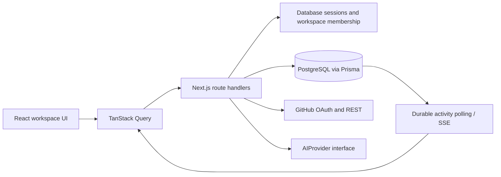

# DevFlow architecture

## Shape of the application

A single Next.js App Router application owns the interface and Node.js route handlers. The home page checks the session before rendering the client shell. Route handlers independently authenticate and authorize every resource; hiding a control in the UI is never the authorization boundary.

- `src/app/page.tsx`: protected entry point, preserves invitation context through sign-in.
- `src/components/devflow.tsx`: workspace shell, navigation, query invalidation, keyboard shortcuts, SSE lifecycle, optimistic board writes.
- `src/components/workspace-views.tsx`: dashboard, task lists, projects, activity, Recharts analytics.
- `src/components/kanban.tsx`: dnd-kit sensors, sortable cards, droppable columns, filtering, ordering.
- `src/components/task-dialog.tsx`: React Hook Form/Zod creation forms and versioned task editing, comments and history.
- `src/components/integrations.tsx`: settings, AI composer, GitHub repository/activity panels.
- `src/components/ui`: locally owned shadcn-style Button and accessible Radix Dialog primitives; `components.json` enables further shadcn generation.
- `src/lib/server`: database, sessions, request limits, typed errors, environment parsing, cryptography and provider adapters.
- `src/lib/analytics.ts`, `validation.ts`, `kanban.ts`: pure, tested domain calculations.

TanStack Query owns server state. Zustand stores only theme/workspace preferences and transient toasts. Component-local state owns filters and dialogs. Theme tokens, compact typography, low-contrast borders, lavender accents, responsive grids and CSS artwork establish the design. System fonts keep startup independent of font/CDN availability. Motion transitions respect the global reduced-motion override.

## Data model

`User` has many `Session`, `WorkspaceMember`, authored comments, activities, notifications, and assigned tasks, plus an optional `GitHubConnection`. Users and workspaces form a many-to-many relation through `WorkspaceMember`; `(workspaceId,userId)` is unique. Roles are OWNER, ADMIN, and MEMBER. Only owner/admin members may issue invitations.

A workspace contains projects, labels, invitations and activity. Each task belongs to exactly one project and optionally one assignee. Labels connect through `TaskLabel` with a composite primary key; names are unique per workspace. The task number is a database-generated unique serial reference. The board uses status, fractional position and an integer version. Task updates check and increment that version atomically. Status changes set/clear `completedAt`; analytics uses the timestamp of the current completion, not a fabricated history.

Comments cascade with tasks. Task activity retains actor/workspace context when a task is deleted by setting its task FK to null. Deleting workspaces cascades their project/member/label/invite/activity records. Deleting assignees sets task assignees to null. Database indexes cover session tokens/expiry, member lookups, project workspace/archive state, task board order/due dates/assignment, and activity chronology.

`RateLimit` implements shared fixed-window counters with PostgreSQL upsert. It works across Node processes; `db:cleanup` expires old buckets, sessions and invitations. No in-memory state is required for authentication or activity delivery.

## Request and security boundaries

Mutation requests must carry the exact configured application Origin. Requests without Origin are rejected rather than exempting scripts. API clients should explicitly supply that header. JSON bodies are streamed into a bounded buffer, capped at 64 KB, and parsed/validated by Zod. Avatars have a separate 512 KB bound and PNG/JPEG signature checks. Foreign task, project, assignee, and label IDs are checked against the authorized workspace before writing.

Sessions use 256-bit random opaque tokens, SHA-256 token digests in the database, a 14-day expiry, and HTTP-only SameSite=Lax cookies. Production uses Secure cookies. Passwords use Node scrypt, random salts, and timing-safe comparisons. Login performs a dummy password calculation when the email is absent. Shared database limits bound global hashing work and account-specific attempts. Password changes verify the current password and revoke old sessions. This is a custom authentication layer, not an Auth.js integration; see the README’s production-readiness caveat.

The API serializes explicit public user fields. Password hashes, avatar bytes and integration credentials are not included in snapshots. Private avatars require the current user or membership in a shared workspace. Errors return sanitized messages; server logs omit raw upstream bodies and credential values.

OAuth starts with an authenticated session and a short-lived state cookie; callbacks validate state before exchanging the code server-side. AES-256-GCM encrypts GitHub tokens with a server-only 32-byte key. User disconnection removes the local connection record. GitHub code runs only on the server. A project repository link stores its `owner/name`, not a token.

AI API keys are server environment values. The adapter sends only authorized project/task context to the configured endpoint, applies timeouts and quotas, rejects provider errors/empty output, and returns plain text. No configured key means an explicit configuration error. Model text cannot directly mutate the database.

## Real-time behavior

SSE connections poll the latest durable workspace activity plus online membership every two seconds. A changed fingerprint causes query invalidation, refreshing tasks, comments, history and the team feed. Heartbeats update the current member every 15 seconds; members are considered online for 45 seconds. Streams recheck session validity and membership, clean up timers on abort, and rotate after four minutes. EventSource reconnects automatically with a three-second retry; a 30-second snapshot poll provides a fallback when streaming fails.

This favors simple multi-process correctness without an in-memory event bus, Redis, or a second server. It trades two-second latency and repeated database reads for fewer operational dependencies. A larger installation should use a durable event sequence and shared pub/sub transport. Profile changes and label additions also appear on the periodic fallback refresh.

## API surface

| Route                                         | Methods                   | Purpose                                         |
| --------------------------------------------- | ------------------------- | ----------------------------------------------- |
| `/api/auth/register`, `/api/auth/login`       | POST                      | Accounts and sessions                           |
| `/api/auth/logout`                            | POST                      | Revoke current session                          |
| `/api/me`                                     | GET                       | Safe profile and memberships                    |
| `/api/profile`, `/api/avatar`                 | PATCH / POST              | Profile/password and private avatar upload      |
| `/api/avatar/:id`                             | GET                       | Authorized avatar bytes                         |
| `/api/workspaces`                             | POST                      | New workspace with owner membership             |
| `/api/snapshot`                               | GET                       | Authorized workspace data                       |
| `/api/projects`, `/api/projects/:id`          | POST / PATCH              | Project creation, edits, links, archive/restore |
| `/api/tasks`, `/api/tasks/:id`                | POST / GET, PATCH, DELETE | Task CRUD and versioned moves                   |
| `/api/tasks/:id/comments`                     | POST                      | Comments with activity                          |
| `/api/labels`                                 | POST                      | Create workspace labels                         |
| `/api/invites`, `/api/invites/accept`         | POST                      | Email-bound invitation links/acceptance         |
| `/api/heartbeat`, `/api/events`               | POST / GET                | Presence and SSE                                |
| `/api/notifications/read`                     | POST                      | Read own notifications                          |
| `/api/github`                                 | GET, DELETE               | Own GitHub repositories/activity or disconnect  |
| `/api/github/connect`, `/api/github/callback` | GET                       | OAuth round trip                                |
| `/api/ai`                                     | POST                      | Authorized assistant requests                   |

Scoped endpoints require `?workspaceId=...`. Authentication, current profile, workspace creation and invite acceptance determine their own scope and do not require it. GET GitHub optionally takes `projectId`. Mutations return consistent JSON errors and meaningful 400/401/403/404/409/413/415/429/502/503 status codes.

## Roadmaps and scheduling

`src/lib/roadmap.ts` contains UTC calendar calculations, graph ordering/cycle checks,
CPM/slack, interval shifting and deadline/conflict classification. The new roadmap
component extends the existing theme and dnd-kit setup. TanStack Query owns roadmap
snapshots and is invalidated by existing activity/SSE and task mutations.

`src/lib/server/roadmap.ts` enforces actor/workspace scope independently of the route.
Graph mutations lock the authorized active project row before reading edges under
READ COMMITTED. Task creation/edit/delete/comment transactions use the same project
lock, serializing them with archive/dependency changes. Roadmap reads use repeatable
read to keep project tasks and edges consistent. Task versions still guard stale writes.

An additive migration adds nullable start dates, milestone flags and a dependency
join table with same-project composite foreign keys, uniqueness and cascade cleanup.
SQL constraints protect date ordering and milestone validity. Cycle checking lives
in the serialized service; direct graph writers must use equivalent validation.
Existing tasks are not assigned artificial schedules. See README and UPGRADE_REPORT
for precise CPM definitions and the roadmap API contract.

## Agentic AI project manager

The existing read-only assistant remains available as Quick drafts. A separate
project-manager interface uses `AgentProvider` with strict tool schemas, persisted
private conversations and a bounded read-and-preview loop. It queries authorized
project/task records, returning explicit totals/limits and metadata useful for
assignment/blocker/sprint/report planning. It has no model-accessible executor or
approval tool. Provider keys, passwords and integration credentials are not selected
into context or returned to the browser.

Each proposed write stores the normalized action, human-readable preview, canonical
integrity digest, server-captured task versions, expiry and state. An authenticated
actor must explicitly approve the displayed hash through a separate decision route.
That route locks the owned proposal, rechecks membership/scope/integrity/expiry and
uses the shared task or sprint/report service under a project lock. Domain writes
and the result receipt commit atomically; repeated approvals replay the receipt.
Normal task routes and AI approvals share `tasks.ts`, preserving board ordering,
labels, notifications, date validation and optimistic versions.

Conversation row locks and request UUID uniqueness serialize turns; the migration
also enforces one RUNNING row per conversation with a SQL partial unique index.
Provider calls run outside transactions with bounded time/output/context. Expired
runs are fenced against late finalization. Tool events are durable per step even if
later provider work fails. Conversations are private to their owner/current workspace
membership; approved artifacts are shared project data. Sprint tasks retain planning
baselines, and reports retain actual snapshot metrics with explicit limitations.

The additive AI migration introduces nullable task-parent links and seven tables:
AIConversation, AIRun, AIToolEvent, AIProposal, Sprint, SprintTask and ProjectReport.
See AI_PROJECT_MANAGER.md for full state/approval semantics, API endpoints and budgets.

## Validation and delivery

Prisma schema/client generation, full/core TypeScript, ESLint, 75 unit tests, all
three SQL constraint suites and a webpack production build pass. All migrations
were applied only to fresh isolated PostgreSQL standalone clusters. Live
API/concurrent execution, browser UI and real provider checks remain open release
gates; known prohibited infrastructure operations were not retried for Milestone 2.
See UPGRADE_REPORT.md and VERIFICATION.md for actual results/local commands.
Milestone 3 and later phases have not been started.
